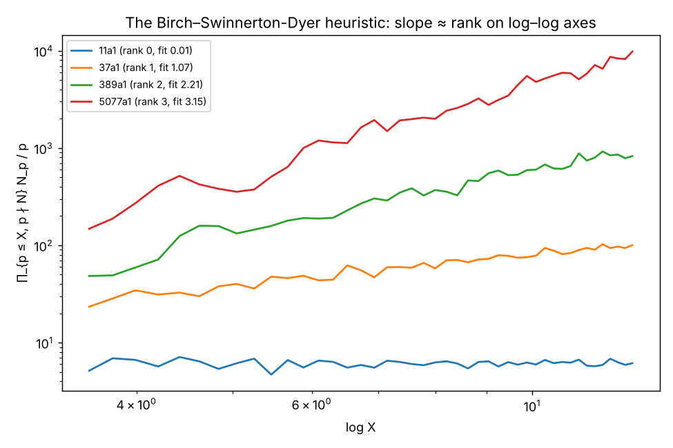

# 5. Numerical evidence produced by this repository

All numbers below were computed by `python -m bsd …` with PARI/GP 2.17 (cypari2) in this repository, and compared against John Cremona's independently computed tables (eclib/mwrank). Raw outputs are in `results/*.jsonl`; this file is generated by `scripts/make_evidence_doc.py`.

**Reading guide.** "$\#Ш_{\mathrm{an}}$ is a square" and "agrees with Cremona" are *evidence* for formula (II). "THEOREM" lines are theorems. For rank $\ge2$ curves the only rigorous outputs are the 2-descent rank bounds, the exact vanishing $L(E,1)=0$, and the prime-by-prime finiteness of $Ш[p^\infty]$.

## 5.1 Systematic sweeps over Cremona's database

For every curve: invariants, analytic rank and leading term, exact $L(E,1)/\Omega^+$ by modular symbols, an independent 2-descent (PARI `ellrank`, seeded with Cremona's generators, which it re-verifies), saturation at all primes $<1000$, regulator, $\#Ш_{\mathrm{an}}$, and the theorem ledger.

| conductor range | curves | analytic ranks | $\#Ш_{\mathrm{an}}$ values | non-square $\#Ш_{\mathrm{an}}$ | max rel. error of $\#Ш_{\mathrm{an}}$ | 2-descent pins rank | $Ш[2]\ne0$ detected | mismatches with Cremona | errors |
|---|---|---|---|---|---|---|---|---|---|
| 0001–1000 | 5113 | 0: 3081, 1: 2014, 2: 18 | 1: 5007, 4: 67, 9: 27, 16: 5, 25: 5, 49: 2 | 0 | 2.3e-15 | 5108 | 67 | 0 | 0 |
| 1001–10000 | 9312 | 0: 4650, 1: 4495, 2: 167 | 1: 8995, 4: 229, 9: 44, 16: 25, 25: 14, 36: 1, 49: 2, 64: 2 | 0 | 1.2e-15 | 9286 | 231 | 0 | 0 |

**Totals: 14425 curves.** Analytic ranks: 0: 7731, 1: 6509, 2: 185. $\#Ш_{\mathrm{an}}$: 1: 14002, 4: 296, 9: 71, 16: 30, 25: 19, 36: 1, 49: 4, 64: 2. Non-square: 0. Mismatches with Cremona's tables: 0. Errors: 0.
Rigorous status of $\operatorname{ord}_{s=1}L$: exact: 14425.
Curves of analytic rank $\le1$ for which the mechanised theorems prove the $p$-part of (II) at **every** prime $p\ge5$ in the ledger: 2388 of 14240.

### Proofs of the full formula with Sage, conductor range 0001–1000 (1092 curves)

Same pipeline, plus Sage's provable saturation of every Mordell–Weil basis and, for analytic rank ≤ 1, Sage's `prove_BSD`.

**Sage `prove_BSD` (Kolyvagin + Kato bounds, 2-descent, Cha/Jetchev/Lawson–Wuthrich/Stein–Wuthrich refinements):** full formula (II) proven at every prime for **964** curves; proven at all but the listed primes for 128 curves (unproven primes, with multiplicity: 3: 119, 5: 9); not applicable/failed for 0. Provable saturation changed a PARI basis in 0 cases.

Curves where `prove_BSD` leaves primes open (label: primes): 36a1: [3], 36a2: [3], 36a3: [3], 36a4: [3], 90a1: [3], 90a2: [3], 90a3: [3], 90a4: [3], 90b1: [3], 90b2: [3], 90b3: [3], 90b4: [3], 90c1: [3], 90c2: [3], 90c3: [3], 90c4: [3], 90c5: [3], 90c6: [3], 90c7: [3], 90c8: [3], 91b1: [3], 91b2: [3], 91b3: [3], 108a1: [3], 108a2: [3], 126a1: [3], 126a2: [3], 126a3: [3], 126a4: [3], 126a5: [3], 126a6: [3], 124a1: [3], 124a2: [3], 130a1: [3], 130a2: [3], 130a3: [3], 130a4: [3], 150a1: [5], 150a2: [5], 150a3: [5], 150a4: [5], 153b2: [3], 153b1: [3], 162a1: [3], 162a2: [3], 162b1: [3], 162b2: [3], 162b3: [3], 162b4: [3], 162c1: [3], 162c2: [3], 162c3: [3], 162c4: [3], 162d1: [3], 162d2: [3], 171b1: [3], 171b2: [3], 171b3: [3], 172a1: [3], 172a2: [3], 175a1: [5], 175a2: [5], 180a1: [3], 180a2: [3], 180a3: [3], 180a4: [3], 185a1: [3], 189b3: [3], 189b1: [3], 189b2: [3], 198b2: [3], 198b3: [3], 198b4: [3], 198c1: [3], 198b1: [3], 198c2: [3], 198c3: [3], 198c4: [3], 198d1: [3], 198d2: [3], 198d3: [3], 198d4: [3], 198e1: [3], 198e2: [3], 198e3: [3], 198e4: [3], 201c1: [3], 209a1: [3], 209a2: [3], 218a1: [3], 220a1: [3], 220a2: [3], 218a2: [3], 219b1: [3], 219b2: [3], 220a3: [3], 220a4: [3], 225b1: [3], 225b2: [3], 234e1: [3], 234e2: [3], 234e3: [3], 243a1: [3], 243a2: [3], 243b1: [3], 243b2: [3], 245c1: [3], 245c2: [3], 245c3: [3], 252a1: [3], 252a2: [3], 252a3: [3], 252a4: [3], 254a1: [3], 254a2: [3], 254a3: [3], 270a1: [3], 270a2: [3], 270b1: [3], 270b2: [3], 270c1: [3], 270c2: [3], 270d1: [3], 270d2: [3], 274b1: [3], 275b1: [5], 275b2: [5], 275b3: [5]

## 5.2 Curated curves (every feature of the conjecture, ranks 0–7)

| curve | N | r_an | rigorous ord | 2-descent rank bounds | #tors | ∏c_p | Ω_E | Reg | L^(r)(E,1)/r! | Ш_an | square? | status |
|---|---|---|---|---|---|---|---|---|---|---|---|---|
| 11a1 | 11 | 0 | = 0 | [0,0] | 5 | 5 | 1.269209304 | 1 | 0.2538418609 | 1 | yes | theorem |
| 14a1 | 14 | 0 | = 0 | [0,0] | 6 | 6 | 1.981341956 | 1 | 0.3302236593 | 1 | yes | theorem |
| 15a1 | 15 | 0 | = 0 | [0,0] | 8 | 8 | 2.801206085 | 1 | 0.3501507606 | 1 | yes | theorem |
| 17a1 | 17 | 0 | = 0 | [0,0] | 4 | 4 | 1.547079754 | 1 | 0.3867699384 | 1 | yes | theorem |
| 19a1 | 19 | 0 | = 0 | [0,0] | 3 | 3 | 1.359759733 | 1 | 0.4532532445 | 1 | yes | theorem |
| 27a1 | 27 | 0 | = 0 | [0,0] | 3 | 3 | 1.76663875 | 1 | 0.5888795834 | 1 | yes | theorem |
| 32a2 | 32 | 0 | = 0 | [0,0] | 4 | 2 | 5.244115109 | 1 | 0.6555143886 | 1 | yes | theorem |
| 36a1 | 36 | 0 | = 0 | [0,0] | 6 | 6 | 4.206546316 | 1 | 0.7010910527 | 1 | yes | theorem |
| 37a1 | 37 | 1 | = 1 | [1,1] | 1 | 1 | 5.986917292 | 0.05111140824 | 0.3059997738 | 1 | yes | theorem |
| 37b1 | 37 | 0 | = 0 | [0,0] | 3 | 3 | 2.177043186 | 1 | 0.7256810619 | 1 | yes | theorem |
| 43a1 | 43 | 1 | = 1 | [1,1] | 1 | 1 | 5.46868953 | 0.06281650709 | 0.3435239746 | 1 | yes | theorem |
| 49a1 | 49 | 0 | = 0 | [0,0] | 2 | 2 | 1.933311706 | 1 | 0.9666558528 | 1 | yes | theorem |
| 53a1 | 53 | 1 | = 1 | [1,1] | 1 | 1 | 4.687641049 | 0.09298148464 | 0.4358638242 | 1 | yes | theorem |
| 57a1 | 57 | 1 | = 1 | [1,1] | 1 | 2 | 5.555504521 | 0.03757459274 | 0.4174916397 | 1 | yes | theorem |
| 65a1 | 65 | 1 | = 1 | [1,1] | 2 | 1 | 5.382853471 | 0.3755140987 | 0.5053343423 | 1 | yes | theorem |
| 67a1 | 67 | 0 | = 0 | [0,0] | 1 | 1 | 1.273770037 | 1 | 1.273770037 | 1 | yes | theorem |
| 91a1 | 91 | 1 | = 1 | [1,1] | 1 | 1 | 3.897260937 | 0.1423921507 | 0.5549393665 | 1 | yes | theorem |
| 91b1 | 91 | 1 | = 1 | [1,1] | 3 | 1 | 6.039491536 | 1.059245086 | 0.7108113038 | 1 | yes | theorem |
| 121b1 | 121 | 1 | = 1 | [1,1] | 1 | 2 | 4.802421322 | 0.08978515616 | 0.8623722967 | 1 | yes | theorem |

### Finiteness of $Ш[p^\infty]$ for curves of rank $\ge2$ (Kato + $p$-adic $L$-functions)

For each good ordinary odd prime $p$ in the range computed, PARI certifies an upper bound $r_p$ for $\operatorname{ord}_{T=0}L_p(E,T)$; when $r_p$ equals the number of independent points found, Kato's theorem and Mazur's control theorem give $\operatorname{corank}\operatorname{Sel}_{p^\infty}=r$, i.e. $Ш[p^\infty]$ is finite (see `bsd/theorems.py`). The column $L_p/R_p$ is the $p$-adic BSD quotient, conjecturally $\#Ш$.

| curve | rank | primes $p$ with $Ш[p^\infty]$ proven finite | primes not certified | $L_p^{(r)}(0)/r!\,/\,R_p$ (p-adic BSD) |
|---|---|---|---|---|

### Curve-by-curve detail

*smallest conductor; rank 0; E(Q)_tors = Z/5, c_11 = 5, L(E,1)/Ω = 1/5*

### 11a1

Minimal model a-invariants `[0, -1, 1, -10, -20]`, conductor N = 11, Δ_min = -161051, root number 1, torsion [5].
Bad primes — p=11: split multiplicative, Kodaira I5, ord_p Δ = 5, c_p = 5.
Rational isogeny degrees from E: [1, 5] (E[ℓ] reducible for ℓ in [5]).

**Analytic side.** ord_{s=1} L(E,s) = 0 numerically; L^(0)(E,1)/0! = 0.253841860855911. Exact L(E,1)/Ω⁺ = 1/5 (modular symbols). L(E,1)/Ω⁺ is a non-zero rational (modular symbols): ord = 0 rigorously.

**Algebraic side.** 2-descent: 0 ≤ rank ≤ 0 (Ш[2]/2Ш[4] has 2-rank 0). Saturated generators (ellrank, saturated at primes < 1000): none; regulator 1.

**BSD quotient.** Ω_E = 1.26920930427955, ∏c_p = 5, #tors = 5, so L^(r)(E,1)/r! ÷ (Ω·Reg·∏c_p/#tors²) = **1** → #Ш_an = 1 (a perfect square, as Cassels' theorem requires)

**Status.** THEOREM: rank E(Q) = 0 and Ш(E/Q) is finite (L(E,1) ≠ 0 certified by modular symbols; Kolyvagin 1988/Gross–Zagier 1986, independently Kato 2004). 2-descent independently gives rank 0. Ш: finite (theorem).
p-part of the BSD formula proven by the mechanised theorems at p ∈ {3, 7, 13, 17, 23, 31, 37, 41, 43, 47, 53, 59, 61, 67, 71, 73, 79, 83, 89, 97}; not covered by them at p ∈ {2, 5, 11, 19, 29}.
**Ш[p^∞] is finite for p ∈ {3, 5, 7, 13, 17, 23, 31, 37, 41, 43, 47, 53, 59, 61, 67, 71, 73, 79, 83, 89, 97}** (Kato 2004 + Mazur's control theorem + certified vanishing order of the p-adic L-function; cf. Stein–Wuthrich 2013).
p-adic BSD check (L_p^{(r)}(0)/r! ÷ p-adic regulator, conjecturally #Ш): p=3: 1 + O(3^5); p=5: 1 + O(5^4); p=7: 1 + O(7^5); p=13: 1 + O(13^5); p=17: 1 + O(17^5); p=19: [1 + O(19^7), O(19^7)]; p=23: 1 + O(23^5); p=29: [1 + O(29^7), O(29^7)]; p=31: 1 + O(31^5); p=37: 1 + O(37^5); p=41: 1 + O(41^5); p=43: 1 + O(43^5); p=47: 1 + O(47^5); p=53: 1 + O(53^5); p=59: 1 + O(59^5); p=61: 1 + O(61^5); p=67: 1 + O(67^5); p=71: 1 + O(71^5); p=73: 1 + O(73^5); p=79: 1 + O(79^5); p=83: 1 + O(83^5); p=89: 1 + O(89^5); p=97: 1 + O(97^5).
Cross-check with Cremona's tables (independent software): rank 0, Reg 1.0, Ш_an 1.0 — agree.

*rank 0, torsion Z/6*

### 14a1

Minimal model a-invariants `[1, 0, 1, 4, -6]`, conductor N = 14, Δ_min = -21952, root number 1, torsion [6].
Bad primes — p=2: nonsplit multiplicative, Kodaira I6, ord_p Δ = 6, c_p = 2, p=7: split multiplicative, Kodaira I3, ord_p Δ = 3, c_p = 3.
Rational isogeny degrees from E: [1, 2, 3, 6] (E[ℓ] reducible for ℓ in [2, 3]).

**Analytic side.** ord_{s=1} L(E,s) = 0 numerically; L^(0)(E,1)/0! = 0.330223659344481. Exact L(E,1)/Ω⁺ = 1/6 (modular symbols). L(E,1)/Ω⁺ is a non-zero rational (modular symbols): ord = 0 rigorously.

**Algebraic side.** 2-descent: 0 ≤ rank ≤ 0 (Ш[2]/2Ш[4] has 2-rank 0). Saturated generators (ellrank, saturated at primes < 1000): none; regulator 1.

**BSD quotient.** Ω_E = 1.98134195606688, ∏c_p = 6, #tors = 6, so L^(r)(E,1)/r! ÷ (Ω·Reg·∏c_p/#tors²) = **1** → #Ш_an = 1 (a perfect square, as Cassels' theorem requires)

**Status.** THEOREM: rank E(Q) = 0 and Ш(E/Q) is finite (L(E,1) ≠ 0 certified by modular symbols; Kolyvagin 1988/Gross–Zagier 1986, independently Kato 2004). 2-descent independently gives rank 0. Ш: finite (theorem).
p-part of the BSD formula proven by the mechanised theorems at p ∈ {13, 17, 19, 29, 31, 37, 41, 43, 47, 53, 59, 61, 67, 73, 79, 83, 89, 97}; not covered by them at p ∈ {2, 3, 5, 7, 11, 23, 71}.
**Ш[p^∞] is finite for p ∈ {3, 13, 17, 19, 29, 31, 37, 41, 43, 47, 53, 59, 61, 67, 73, 79, 83, 89, 97}** (Kato 2004 + Mazur's control theorem + certified vanishing order of the p-adic L-function; cf. Stein–Wuthrich 2013).
p-adic BSD check (L_p^{(r)}(0)/r! ÷ p-adic regulator, conjecturally #Ш): p=3: 1 + O(3^4); p=5: [1 + O(5^6), O(5^6)]; p=11: [1 + O(11^7), O(11^7)]; p=13: 1 + O(13^5); p=17: 1 + O(17^5); p=19: 1 + O(19^5); p=23: [1 + O(23^7), O(23^7)]; p=29: 1 + O(29^5); p=31: 1 + O(31^5); p=37: 1 + O(37^5); p=41: 1 + O(41^5); p=43: 1 + O(43^5); p=47: 1 + O(47^5); p=53: 1 + O(53^5); p=59: 1 + O(59^5); p=61: 1 + O(61^5); p=67: 1 + O(67^5); p=71: [1 + O(71^7), O(71^7)]; p=73: 1 + O(73^5); p=79: 1 + O(79^5); p=83: 1 + O(83^5); p=89: 1 + O(89^5); p=97: 1 + O(97^5).
Cross-check with Cremona's tables (independent software): rank 0, Reg 1.0, Ш_an 1.0 — agree.

*rank 0, torsion Z/4 × Z/2*

### 15a1

Minimal model a-invariants `[1, 1, 1, -10, -10]`, conductor N = 15, Δ_min = 50625, root number 1, torsion [4, 2].
Bad primes — p=3: nonsplit multiplicative, Kodaira I4, ord_p Δ = 4, c_p = 2, p=5: split multiplicative, Kodaira I4, ord_p Δ = 4, c_p = 4.
Rational isogeny degrees from E: [1, 2, 4] (E[ℓ] reducible for ℓ in [2]).

**Analytic side.** ord_{s=1} L(E,s) = 0 numerically; L^(0)(E,1)/0! = 0.350150760583151. Exact L(E,1)/Ω⁺ = 1/4 (modular symbols). L(E,1)/Ω⁺ is a non-zero rational (modular symbols): ord = 0 rigorously.

**Algebraic side.** 2-descent: 0 ≤ rank ≤ 0 (Ш[2]/2Ш[4] has 2-rank 0). Saturated generators (ellrank, saturated at primes < 1000): none; regulator 1.

**BSD quotient.** Ω_E = 2.8012060846652, ∏c_p = 8, #tors = 8, so L^(r)(E,1)/r! ÷ (Ω·Reg·∏c_p/#tors²) = **1** → #Ш_an = 1 (a perfect square, as Cassels' theorem requires)

**Status.** THEOREM: rank E(Q) = 0 and Ш(E/Q) is finite (L(E,1) ≠ 0 certified by modular symbols; Kolyvagin 1988/Gross–Zagier 1986, independently Kato 2004). 2-descent independently gives rank 0. Ш: finite (theorem).
p-part of the BSD formula proven by the mechanised theorems at p ∈ {11, 13, 17, 19, 29, 37, 41, 43, 47, 53, 59, 61, 67, 71, 73, 83, 89, 97}; not covered by them at p ∈ {2, 3, 5, 7, 23, 31, 79}.
**Ш[p^∞] is finite for p ∈ {11, 13, 17, 19, 29, 37, 41, 43, 47, 53, 59, 61, 67, 71, 73, 83, 89, 97}** (Kato 2004 + Mazur's control theorem + certified vanishing order of the p-adic L-function; cf. Stein–Wuthrich 2013).
p-adic BSD check (L_p^{(r)}(0)/r! ÷ p-adic regulator, conjecturally #Ш): p=7: [1 + O(7^6), O(7^6)]; p=11: 1 + O(11^5); p=13: 1 + O(13^5); p=17: 1 + O(17^5); p=19: 1 + O(19^5); p=23: [1 + O(23^7), O(23^7)]; p=29: 1 + O(29^5); p=31: [1 + O(31^7), O(31^7)]; p=37: 1 + O(37^5); p=41: 1 + O(41^5); p=43: 1 + O(43^5); p=47: 1 + O(47^5); p=53: 1 + O(53^5); p=59: 1 + O(59^5); p=61: 1 + O(61^5); p=67: 1 + O(67^5); p=71: 1 + O(71^5); p=73: 1 + O(73^5); p=79: [1 + O(79^7), O(79^7)]; p=83: 1 + O(83^5); p=89: 1 + O(89^5); p=97: 1 + O(97^5).
Cross-check with Cremona's tables (independent software): rank 0, Reg 1.0, Ш_an 1.0 — agree.

*rank 0, torsion Z/4*

### 17a1

Minimal model a-invariants `[1, -1, 1, -1, -14]`, conductor N = 17, Δ_min = -83521, root number 1, torsion [4].
Bad primes — p=17: split multiplicative, Kodaira I4, ord_p Δ = 4, c_p = 4.
Rational isogeny degrees from E: [1, 2, 4] (E[ℓ] reducible for ℓ in [2]).

**Analytic side.** ord_{s=1} L(E,s) = 0 numerically; L^(0)(E,1)/0! = 0.38676993838778. Exact L(E,1)/Ω⁺ = 1/4 (modular symbols). L(E,1)/Ω⁺ is a non-zero rational (modular symbols): ord = 0 rigorously.

**Algebraic side.** 2-descent: 0 ≤ rank ≤ 0 (Ш[2]/2Ш[4] has 2-rank 0). Saturated generators (ellrank, saturated at primes < 1000): none; regulator 1.

**BSD quotient.** Ω_E = 1.54707975355112, ∏c_p = 4, #tors = 4, so L^(r)(E,1)/r! ÷ (Ω·Reg·∏c_p/#tors²) = **1** → #Ш_an = 1 (a perfect square, as Cassels' theorem requires)

**Status.** THEOREM: rank E(Q) = 0 and Ш(E/Q) is finite (L(E,1) ≠ 0 certified by modular symbols; Kolyvagin 1988/Gross–Zagier 1986, independently Kato 2004). 2-descent independently gives rank 0. Ш: finite (theorem).
p-part of the BSD formula proven by the mechanised theorems at p ∈ {5, 7, 13, 19, 23, 29, 31, 37, 41, 43, 53, 59, 61, 67, 71, 73, 79, 83, 89, 97}; not covered by them at p ∈ {2, 3, 11, 17, 47}.
**Ш[p^∞] is finite for p ∈ {5, 7, 13, 19, 23, 29, 31, 37, 41, 43, 53, 59, 61, 67, 71, 73, 79, 83, 89, 97}** (Kato 2004 + Mazur's control theorem + certified vanishing order of the p-adic L-function; cf. Stein–Wuthrich 2013).
p-adic BSD check (L_p^{(r)}(0)/r! ÷ p-adic regulator, conjecturally #Ш): p=3: [1 + O(3^6), O(3^6)]; p=5: 1 + O(5^5); p=7: 1 + O(7^5); p=11: [1 + O(11^7), O(11^7)]; p=13: 1 + O(13^5); p=19: 1 + O(19^5); p=23: 1 + O(23^5); p=29: 1 + O(29^5); p=31: 1 + O(31^5); p=37: 1 + O(37^5); p=41: 1 + O(41^5); p=43: 1 + O(43^5); p=47: [1 + O(47^7), O(47^7)]; p=53: 1 + O(53^5); p=59: 1 + O(59^5); p=61: 1 + O(61^5); p=67: 1 + O(67^5); p=71: 1 + O(71^5); p=73: 1 + O(73^5); p=79: 1 + O(79^5); p=83: 1 + O(83^5); p=89: 1 + O(89^5); p=97: 1 + O(97^5).
Cross-check with Cremona's tables (independent software): rank 0, Reg 1.0, Ш_an 1.0 — agree.

*rank 0, torsion Z/3*

### 19a1

Minimal model a-invariants `[0, 1, 1, -9, -15]`, conductor N = 19, Δ_min = -6859, root number 1, torsion [3].
Bad primes — p=19: split multiplicative, Kodaira I3, ord_p Δ = 3, c_p = 3.
Rational isogeny degrees from E: [1, 3] (E[ℓ] reducible for ℓ in [3]).

**Analytic side.** ord_{s=1} L(E,s) = 0 numerically; L^(0)(E,1)/0! = 0.453253244496104. Exact L(E,1)/Ω⁺ = 1/3 (modular symbols). L(E,1)/Ω⁺ is a non-zero rational (modular symbols): ord = 0 rigorously.

**Algebraic side.** 2-descent: 0 ≤ rank ≤ 0 (Ш[2]/2Ш[4] has 2-rank 0). Saturated generators (ellrank, saturated at primes < 1000): none; regulator 1.

**BSD quotient.** Ω_E = 1.35975973348831, ∏c_p = 3, #tors = 3, so L^(r)(E,1)/r! ÷ (Ω·Reg·∏c_p/#tors²) = **1** → #Ш_an = 1 (a perfect square, as Cassels' theorem requires)

**Status.** THEOREM: rank E(Q) = 0 and Ш(E/Q) is finite (L(E,1) ≠ 0 certified by modular symbols; Kolyvagin 1988/Gross–Zagier 1986, independently Kato 2004). 2-descent independently gives rank 0. Ш: finite (theorem).
p-part of the BSD formula proven by the mechanised theorems at p ∈ {5, 7, 11, 13, 17, 29, 31, 37, 41, 43, 47, 53, 59, 61, 67, 71, 73, 79, 83, 89, 97}; not covered by them at p ∈ {2, 3, 19, 23}.
**Ш[p^∞] is finite for p ∈ {3, 5, 7, 11, 13, 17, 29, 31, 37, 41, 43, 47, 53, 59, 61, 67, 71, 73, 79, 83, 89, 97}** (Kato 2004 + Mazur's control theorem + certified vanishing order of the p-adic L-function; cf. Stein–Wuthrich 2013).
p-adic BSD check (L_p^{(r)}(0)/r! ÷ p-adic regulator, conjecturally #Ш): p=3: 1 + O(3^4); p=5: 1 + O(5^5); p=7: 1 + O(7^5); p=11: 1 + O(11^5); p=13: 1 + O(13^5); p=17: 1 + O(17^5); p=23: [1 + O(23^7), O(23^7)]; p=29: 1 + O(29^5); p=31: 1 + O(31^5); p=37: 1 + O(37^5); p=41: 1 + O(41^5); p=43: 1 + O(43^5); p=47: 1 + O(47^5); p=53: 1 + O(53^5); p=59: 1 + O(59^5); p=61: 1 + O(61^5); p=67: 1 + O(67^5); p=71: 1 + O(71^5); p=73: 1 + O(73^5); p=79: 1 + O(79^5); p=83: 1 + O(83^5); p=89: 1 + O(89^5); p=97: 1 + O(97^5).
Cross-check with Cremona's tables (independent software): rank 0, Reg 1.0, Ш_an 1.0 — agree.

*CM by Z[ζ_3] (j = 0), rank 0*

### 27a1

Minimal model a-invariants `[0, 0, 1, 0, -7]`, conductor N = 27, Δ_min = -19683, root number 1, torsion [3], CM by the order of discriminant -3.
Bad primes — p=3: additive, Kodaira IV*, ord_p Δ = 9, c_p = 3.
Rational isogeny degrees from E: [1, 3, 9] (E[ℓ] reducible for ℓ in [3]).

**Analytic side.** ord_{s=1} L(E,s) = 0 numerically; L^(0)(E,1)/0! = 0.588879583428483. Exact L(E,1)/Ω⁺ = 1/3 (modular symbols). L(E,1)/Ω⁺ is a non-zero rational (modular symbols): ord = 0 rigorously.

**Algebraic side.** 2-descent: 0 ≤ rank ≤ 0 (Ш[2]/2Ш[4] has 2-rank 0). Saturated generators (ellrank, saturated at primes < 1000): none; regulator 1.

**BSD quotient.** Ω_E = 1.76663875028545, ∏c_p = 3, #tors = 3, so L^(r)(E,1)/r! ÷ (Ω·Reg·∏c_p/#tors²) = **1** → #Ш_an = 1 (a perfect square, as Cassels' theorem requires)

**Status.** THEOREM: rank E(Q) = 0 and Ш(E/Q) is finite (L(E,1) ≠ 0 certified by modular symbols; Kolyvagin 1988/Gross–Zagier 1986, independently Kato 2004). 2-descent independently gives rank 0. Ш: finite (theorem).
p-part of the BSD formula proven by the mechanised theorems at p ∈ {}; not covered by them at p ∈ {2, 3, 5, 7, 11, 13, 17, 19, 23, 29, 31, 37, 41, 43, 47, 53, 59, 61, 67, 71, 73, 79, 83, 89, 97}.
**Ш[p^∞] is finite for p ∈ {7, 13, 19, 31, 37, 43, 61, 67, 73, 79}** (Kato 2004 + Mazur's control theorem + certified vanishing order of the p-adic L-function; cf. Stein–Wuthrich 2013).
p-adic BSD check (L_p^{(r)}(0)/r! ÷ p-adic regulator, conjecturally #Ш): p=5: [1 + 2*5 + 4*5^2 + 3*5^3 + 2*5^4 + O(5^6), 1 + 5 + 2*5^2 + 4*5^3 + 3*5^4 + 2*5^5 + O(5^6)]; p=7: 1 + O(7^5); p=11: [1 + 3*11 + 4*11^2 + 10*11^3 + 7*11^4 + 6*11^5 + O(11^7), 7 + 3*11^2 + 4*11^3 + 10*11^4 + 7*11^5 + 6*11^6 + O(11^7)]; p=13: 1 + O(13^5); p=17: [1 + 9*17 + 15*17^2 + 10*17^3 + 13*17^4 + 12*17^5 + 11*17^6 + O(17^7), 13 + 11*17 + 14*17^2 + 9*17^3 + 16*17^4 + 7*17^5 + 17^6 + O(17^7)]; p=19: 1 + O(19^5); p=23: [1 + 15*23 + 15*23^2 + 22*23^3 + 7*23^4 + 7*23^5 + O(23^7), 19 + 11*23 + 3*23^2 + 4*23^3 + 11*23^4 + 19*23^5 + 18*23^6 + O(23^7)]; p=29: [1 + 21*29 + 15*29^2 + 5*29^3 + 2*29^4 + 19*29^5 + 17*29^6 + O(29^7), 25 + 11*29 + 9*29^2 + 27*29^3 + 22*29^4 + 13*29^5 + 7*29^6 + O(29^7)]; p=31: 1 + O(31^5); p=37: 1 + O(37^5); p=41: [1 + 33*41 + 15*41^2 + 17*41^3 + 31*41^4 + 41^5 + 6*41^6 + O(41^7), 37 + 11*41 + 21*41^2 + 27*41^3 + 5*41^4 + 2*41^5 + 31*41^6 + O(41^7)]; p=43: 1 + O(43^5); p=47: [1 + 39*47 + 15*47^2 + 23*47^3 + 31*47^4 + 7*47^5 + O(47^7), 43 + 11*47 + 27*47^2 + 27*47^3 + 11*47^4 + 43*47^5 + 42*47^6 + O(47^7)]; p=53: [1 + 45*53 + 15*53^2 + 29*53^3 + 31*53^4 + 13*53^5 + 47*53^6 + O(53^7), 49 + 11*53 + 33*53^2 + 27*53^3 + 17*53^4 + 43*53^5 + 53^6 + O(53^7)]; p=59: [1 + 51*59 + 15*59^2 + 35*59^3 + 31*59^4 + 19*59^5 + 47*59^6 + O(59^7), 55 + 11*59 + 39*59^2 + 27*59^3 + 23*59^4 + 43*59^5 + 7*59^6 + O(59^7)]; p=61: 1 + O(61^5); p=67: 1 + O(67^5); p=73: 1 + O(73^5); p=79: 1 + O(79^5).
Cross-check with Cremona's tables (independent software): rank 0, Reg 1.0, Ш_an 1.0 — agree.

*y² = x³ − x, CM by Z[i], rank 0 (1 is not a congruent number)*

### 32a2

Minimal model a-invariants `[0, 0, 0, -1, 0]`, conductor N = 32, Δ_min = 64, root number 1, torsion [2, 2], CM by the order of discriminant -4.
Bad primes — p=2: additive, Kodaira III, ord_p Δ = 6, c_p = 2.
Rational isogeny degrees from E: [1, 2] (E[ℓ] reducible for ℓ in [2]).

**Analytic side.** ord_{s=1} L(E,s) = 0 numerically; L^(0)(E,1)/0! = 0.65551438857303. Exact L(E,1)/Ω⁺ = 1/4 (modular symbols). L(E,1)/Ω⁺ is a non-zero rational (modular symbols): ord = 0 rigorously.

**Algebraic side.** 2-descent: 0 ≤ rank ≤ 0 (Ш[2]/2Ш[4] has 2-rank 0). Saturated generators (ellrank, saturated at primes < 1000): none; regulator 1.

**BSD quotient.** Ω_E = 5.24411510858424, ∏c_p = 2, #tors = 4, so L^(r)(E,1)/r! ÷ (Ω·Reg·∏c_p/#tors²) = **1** → #Ш_an = 1 (a perfect square, as Cassels' theorem requires)

**Status.** THEOREM: rank E(Q) = 0 and Ш(E/Q) is finite (L(E,1) ≠ 0 certified by modular symbols; Kolyvagin 1988/Gross–Zagier 1986, independently Kato 2004). 2-descent independently gives rank 0. Ш: finite (theorem).
p-part of the BSD formula proven by the mechanised theorems at p ∈ {}; not covered by them at p ∈ {2, 3, 5, 7, 11, 13, 17, 19, 23, 29, 31, 37, 41, 43, 47, 53, 59, 61, 67, 71, 73, 79, 83, 89, 97}.
**Ш[p^∞] is finite for p ∈ {5, 13, 17, 29, 37, 41, 53, 61, 73}** (Kato 2004 + Mazur's control theorem + certified vanishing order of the p-adic L-function; cf. Stein–Wuthrich 2013).
p-adic BSD check (L_p^{(r)}(0)/r! ÷ p-adic regulator, conjecturally #Ш): p=3: [1 + O(3^6), O(3^6)]; p=5: 1 + O(5^5); p=7: [1 + O(7^6), O(7^6)]; p=11: [1 + O(11^7), O(11^7)]; p=13: 1 + O(13^5); p=17: 1 + O(17^5); p=19: [1 + O(19^7), O(19^7)]; p=23: [1 + O(23^7), O(23^7)]; p=29: 1 + O(29^5); p=31: [1 + O(31^7), O(31^7)]; p=37: 1 + O(37^5); p=41: 1 + O(41^5); p=43: [1 + O(43^7), O(43^7)]; p=47: [1 + O(47^7), O(47^7)]; p=53: 1 + O(53^5); p=59: [1 + O(59^7), O(59^7)]; p=61: 1 + O(61^5); p=73: 1 + O(73^5).
Cross-check with Cremona's tables (independent software): rank 0, Reg 1.0, Ш_an 1.0 — agree.

*y² = x³ + 1, CM by Z[ζ_3], rank 0*

### 36a1

Minimal model a-invariants `[0, 0, 0, 0, 1]`, conductor N = 36, Δ_min = -432, root number 1, torsion [6], CM by the order of discriminant -3.
Bad primes — p=2: additive, Kodaira IV, ord_p Δ = 4, c_p = 3, p=3: additive, Kodaira III, ord_p Δ = 3, c_p = 2.
Rational isogeny degrees from E: [1, 2, 3, 6] (E[ℓ] reducible for ℓ in [2, 3]).

**Analytic side.** ord_{s=1} L(E,s) = 0 numerically; L^(0)(E,1)/0! = 0.701091052662727. Exact L(E,1)/Ω⁺ = 1/6 (modular symbols). L(E,1)/Ω⁺ is a non-zero rational (modular symbols): ord = 0 rigorously.

**Algebraic side.** 2-descent: 0 ≤ rank ≤ 0 (Ш[2]/2Ш[4] has 2-rank 0). Saturated generators (ellrank, saturated at primes < 1000): none; regulator 1.

**BSD quotient.** Ω_E = 4.20654631597636, ∏c_p = 6, #tors = 6, so L^(r)(E,1)/r! ÷ (Ω·Reg·∏c_p/#tors²) = **1** → #Ш_an = 1 (a perfect square, as Cassels' theorem requires)

**Status.** THEOREM: rank E(Q) = 0 and Ш(E/Q) is finite (L(E,1) ≠ 0 certified by modular symbols; Kolyvagin 1988/Gross–Zagier 1986, independently Kato 2004). 2-descent independently gives rank 0. Ш: finite (theorem).
p-part of the BSD formula proven by the mechanised theorems at p ∈ {}; not covered by them at p ∈ {2, 3, 5, 7, 11, 13, 17, 19, 23, 29, 31, 37, 41, 43, 47, 53, 59, 61, 67, 71, 73, 79, 83, 89, 97}.
**Ш[p^∞] is finite for p ∈ {7, 13, 19, 31, 37, 43, 61, 67}** (Kato 2004 + Mazur's control theorem + certified vanishing order of the p-adic L-function; cf. Stein–Wuthrich 2013).
p-adic BSD check (L_p^{(r)}(0)/r! ÷ p-adic regulator, conjecturally #Ш): p=5: [1 + O(5^6), O(5^6)]; p=7: 1 + O(7^5); p=11: [1 + O(11^7), O(11^7)]; p=13: 1 + O(13^5); p=17: [1 + O(17^7), O(17^7)]; p=19: 1 + O(19^5); p=23: [1 + O(23^7), O(23^7)]; p=29: [1 + O(29^7), O(29^7)]; p=31: 1 + O(31^5); p=37: 1 + O(37^5); p=41: [1 + O(41^7), O(41^7)]; p=43: 1 + O(43^5); p=47: [1 + O(47^7), O(47^7)]; p=61: 1 + O(61^5); p=67: 1 + O(67^5).
Cross-check with Cremona's tables (independent software): rank 0, Reg 1.0, Ш_an 1.0 — agree.

*smallest conductor of rank 1; generator (0,0)*

### 37a1

Minimal model a-invariants `[0, 0, 1, -1, 0]`, conductor N = 37, Δ_min = 37, root number -1, torsion trivial.
Bad primes — p=37: nonsplit multiplicative, Kodaira I1, ord_p Δ = 1, c_p = 1.
Rational isogeny degrees from E: [1] (E[ℓ] reducible for ℓ in []).

**Analytic side.** ord_{s=1} L(E,s) = 1 numerically; L^(1)(E,1)/1! = 0.305999773834052. Exact L(E,1)/Ω⁺ = 0 (modular symbols). root number -1 forces ord odd, so ord ≥ 1; L(E,1) = 0 exactly (modular symbols); L^{(1)}(E,1) ≠ 0 numerically, so ord = 1 (numerical non-vanishing).

**Algebraic side.** 2-descent: 1 ≤ rank ≤ 1 (Ш[2]/2Ш[4] has 2-rank 0). Saturated generators (supplied+ellrank, saturated at primes < 1000): [['0', '-1']]; regulator 0.0511114082399688.

**BSD quotient.** Ω_E = 5.98691729246392, ∏c_p = 1, #tors = 1, so L^(r)(E,1)/r! ÷ (Ω·Reg·∏c_p/#tors²) = **1** → #Ш_an = 1 (a perfect square, as Cassels' theorem requires)

**Status.** THEOREM (modulo the numerical non-vanishing of L'(E,1)): rank E(Q) = 1 and Ш(E/Q) finite (Gross–Zagier 1986 + Kolyvagin 1990, with Bump–Friedberg–Hoffstein / Murty–Murty 1990-91 for the auxiliary quadratic field). 2-descent independently gives rank 1. Ш: finite (theorem, given L'(E,1) ≠ 0).
p-part of the BSD formula proven by the mechanised theorems at p ∈ {5, 7, 11, 13, 17, 19, 23, 29, 31, 37, 41, 43, 47, 53, 59, 61, 67, 71, 73, 79, 83, 89, 97}; not covered by them at p ∈ {2, 3}.
**Ш[p^∞] is finite for p ∈ {5, 7, 11, 13, 23, 29, 31, 41, 43, 47, 53, 59, 61, 67, 71, 73, 79, 83, 89}** (Kato 2004 + Mazur's control theorem + certified vanishing order of the p-adic L-function; cf. Stein–Wuthrich 2013).
p-adic BSD check (L_p^{(r)}(0)/r! ÷ p-adic regulator, conjecturally #Ш): p=5: 1 + O(5^3); p=7: 1 + O(7^4); p=11: 1 + O(11^4); p=13: 1 + O(13^3); p=23: 1 + O(23^4); p=29: 1 + O(29^4); p=31: 1 + O(31^4); p=41: 1 + O(41^4); p=43: 1 + O(43^4); p=47: 1 + O(47^4); p=53: 1 + O(53^4); p=59: 1 + O(59^4); p=61: 1 + O(61^4); p=67: 1 + O(67^3); p=71: 1 + O(71^4); p=73: 1 + O(73^4); p=79: 1 + O(79^4); p=83: 1 + O(83^4); p=89: 1 + O(89^4).
Cross-check with Cremona's tables (independent software): rank 1, Reg 0.0511114082399688, Ш_an 1.0 — agree.

*same conductor as 37a1 but rank 0, torsion Z/3*

### 37b1

Minimal model a-invariants `[0, 1, 1, -23, -50]`, conductor N = 37, Δ_min = 50653, root number 1, torsion [3].
Bad primes — p=37: split multiplicative, Kodaira I3, ord_p Δ = 3, c_p = 3.
Rational isogeny degrees from E: [1, 3] (E[ℓ] reducible for ℓ in [3]).

**Analytic side.** ord_{s=1} L(E,s) = 0 numerically; L^(0)(E,1)/0! = 0.725681061936153. Exact L(E,1)/Ω⁺ = 2/3 (modular symbols). L(E,1)/Ω⁺ is a non-zero rational (modular symbols): ord = 0 rigorously.

**Algebraic side.** 2-descent: 0 ≤ rank ≤ 0 (Ш[2]/2Ш[4] has 2-rank 0). Saturated generators (ellrank, saturated at primes < 1000): none; regulator 1.

**BSD quotient.** Ω_E = 2.17704318580846, ∏c_p = 3, #tors = 3, so L^(r)(E,1)/r! ÷ (Ω·Reg·∏c_p/#tors²) = **1** → #Ш_an = 1 (a perfect square, as Cassels' theorem requires)

**Status.** THEOREM: rank E(Q) = 0 and Ш(E/Q) is finite (L(E,1) ≠ 0 certified by modular symbols; Kolyvagin 1988/Gross–Zagier 1986, independently Kato 2004). 2-descent independently gives rank 0. Ш: finite (theorem).
p-part of the BSD formula proven by the mechanised theorems at p ∈ {7, 11, 13, 17, 19, 23, 29, 31, 41, 43, 47, 53, 59, 61, 67, 71, 73, 79, 83, 89, 97}; not covered by them at p ∈ {2, 3, 5, 37}.
**Ш[p^∞] is finite for p ∈ {3, 7, 11, 13, 17, 19, 23, 29, 31, 41, 43, 47, 53, 59, 61, 67, 71, 73, 79, 83, 89}** (Kato 2004 + Mazur's control theorem + certified vanishing order of the p-adic L-function; cf. Stein–Wuthrich 2013).
p-adic BSD check (L_p^{(r)}(0)/r! ÷ p-adic regulator, conjecturally #Ш): p=3: 1 + O(3^4); p=5: [1 + O(5^6), O(5^6)]; p=7: 1 + O(7^5); p=11: 1 + O(11^5); p=13: 1 + O(13^5); p=17: 1 + O(17^5); p=19: 1 + O(19^5); p=23: 1 + O(23^5); p=29: 1 + O(29^5); p=31: 1 + O(31^5); p=41: 1 + O(41^5); p=43: 1 + O(43^5); p=47: 1 + O(47^5); p=53: 1 + O(53^5); p=59: 1 + O(59^5); p=61: 1 + O(61^5); p=67: 1 + O(67^5); p=71: 1 + O(71^5); p=73: 1 + O(73^5); p=79: 1 + O(79^5); p=83: 1 + O(83^5); p=89: 1 + O(89^5).
Cross-check with Cremona's tables (independent software): rank 0, Reg 1.0, Ш_an 1.0 — agree.

*rank 1*

### 43a1

Minimal model a-invariants `[0, 1, 1, 0, 0]`, conductor N = 43, Δ_min = -43, root number -1, torsion trivial.
Bad primes — p=43: nonsplit multiplicative, Kodaira I1, ord_p Δ = 1, c_p = 1.
Rational isogeny degrees from E: [1] (E[ℓ] reducible for ℓ in []).

**Analytic side.** ord_{s=1} L(E,s) = 1 numerically; L^(1)(E,1)/1! = 0.343523974618478. Exact L(E,1)/Ω⁺ = 0 (modular symbols). root number -1 forces ord odd, so ord ≥ 1; L(E,1) = 0 exactly (modular symbols); L^{(1)}(E,1) ≠ 0 numerically, so ord = 1 (numerical non-vanishing).

**Algebraic side.** 2-descent: 1 ≤ rank ≤ 1 (Ш[2]/2Ш[4] has 2-rank 0). Saturated generators (supplied+ellrank, saturated at primes < 1000): [['0', '0']]; regulator 0.0628165070874876.

**BSD quotient.** Ω_E = 5.46868952996758, ∏c_p = 1, #tors = 1, so L^(r)(E,1)/r! ÷ (Ω·Reg·∏c_p/#tors²) = **1** → #Ш_an = 1 (a perfect square, as Cassels' theorem requires)

**Status.** THEOREM (modulo the numerical non-vanishing of L'(E,1)): rank E(Q) = 1 and Ш(E/Q) finite (Gross–Zagier 1986 + Kolyvagin 1990, with Bump–Friedberg–Hoffstein / Murty–Murty 1990-91 for the auxiliary quadratic field). 2-descent independently gives rank 1. Ш: finite (theorem, given L'(E,1) ≠ 0).
p-part of the BSD formula proven by the mechanised theorems at p ∈ {3, 5, 7, 11, 13, 17, 19, 23, 29, 31, 37, 41, 43, 47, 53, 59, 61, 67, 71, 73, 79, 83, 89, 97}; not covered by them at p ∈ {2}.
**Ш[p^∞] is finite for p ∈ {3, 5, 11, 13, 17, 19, 23, 29, 31, 41, 47, 53, 59, 61, 67, 71, 73, 79}** (Kato 2004 + Mazur's control theorem + certified vanishing order of the p-adic L-function; cf. Stein–Wuthrich 2013).
p-adic BSD check (L_p^{(r)}(0)/r! ÷ p-adic regulator, conjecturally #Ш): p=3: 1 + O(3^3); p=5: 1 + O(5^3); p=11: 1 + O(11^4); p=13: 1 + O(13^4); p=17: 1 + O(17^4); p=19: 1 + O(19^4); p=23: 1 + O(23^4); p=29: 1 + O(29^4); p=31: 1 + O(31^4); p=41: 1 + O(41^4); p=47: 1 + O(47^4); p=53: 1 + O(53^4); p=59: 1 + O(59^4); p=61: 1 + O(61^4); p=67: 1 + O(67^4); p=71: 1 + O(71^4); p=73: 1 + O(73^4); p=79: 1 + O(79^4).
Cross-check with Cremona's tables (independent software): rank 1, Reg 0.0628165070874876, Ш_an 1.0 — agree.

*CM by Z[(1+√−7)/2], rank 0*

### 49a1

Minimal model a-invariants `[1, -1, 0, -2, -1]`, conductor N = 49, Δ_min = -343, root number 1, torsion [2], CM by the order of discriminant -7.
Bad primes — p=7: additive, Kodaira III, ord_p Δ = 3, c_p = 2.
Rational isogeny degrees from E: [1, 2, 7, 14] (E[ℓ] reducible for ℓ in [2, 7]).

**Analytic side.** ord_{s=1} L(E,s) = 0 numerically; L^(0)(E,1)/0! = 0.966655852808406. Exact L(E,1)/Ω⁺ = 1/2 (modular symbols). L(E,1)/Ω⁺ is a non-zero rational (modular symbols): ord = 0 rigorously.

**Algebraic side.** 2-descent: 0 ≤ rank ≤ 0 (Ш[2]/2Ш[4] has 2-rank 0). Saturated generators (ellrank, saturated at primes < 1000): none; regulator 1.

**BSD quotient.** Ω_E = 1.93331170561681, ∏c_p = 2, #tors = 2, so L^(r)(E,1)/r! ÷ (Ω·Reg·∏c_p/#tors²) = **1** → #Ш_an = 1 (a perfect square, as Cassels' theorem requires)

**Status.** THEOREM: rank E(Q) = 0 and Ш(E/Q) is finite (L(E,1) ≠ 0 certified by modular symbols; Kolyvagin 1988/Gross–Zagier 1986, independently Kato 2004). 2-descent independently gives rank 0. Ш: finite (theorem).
p-part of the BSD formula proven by the mechanised theorems at p ∈ {}; not covered by them at p ∈ {2, 3, 5, 7, 11, 13, 17, 19, 23, 29, 31, 37, 41, 43, 47, 53, 59, 61, 67, 71, 73, 79, 83, 89, 97}.
**Ш[p^∞] is finite for p ∈ {11, 23, 29, 37, 43, 53, 67, 71}** (Kato 2004 + Mazur's control theorem + certified vanishing order of the p-adic L-function; cf. Stein–Wuthrich 2013).
p-adic BSD check (L_p^{(r)}(0)/r! ÷ p-adic regulator, conjecturally #Ш): p=3: [1 + O(3^6), O(3^6)]; p=5: [1 + O(5^6), O(5^6)]; p=11: 1 + O(11^5); p=13: [1 + O(13^7), O(13^7)]; p=17: [1 + O(17^7), O(17^7)]; p=19: [1 + O(19^7), O(19^7)]; p=23: 1 + O(23^5); p=29: 1 + O(29^5); p=31: [1 + O(31^7), O(31^7)]; p=37: 1 + O(37^5); p=41: [1 + O(41^7), O(41^7)]; p=43: 1 + O(43^5); p=47: [1 + O(47^7), O(47^7)]; p=53: 1 + O(53^5); p=67: 1 + O(67^5); p=71: 1 + O(71^5).
Cross-check with Cremona's tables (independent software): rank 0, Reg 1.0, Ш_an 1.0 — agree.

*rank 1, supersingular at 5 (used in the p-adic BSD examples)*

### 53a1

Minimal model a-invariants `[1, -1, 1, 0, 0]`, conductor N = 53, Δ_min = -53, root number -1, torsion trivial.
Bad primes — p=53: nonsplit multiplicative, Kodaira I1, ord_p Δ = 1, c_p = 1.
Rational isogeny degrees from E: [1] (E[ℓ] reducible for ℓ in []).

**Analytic side.** ord_{s=1} L(E,s) = 1 numerically; L^(1)(E,1)/1! = 0.435863824177857. Exact L(E,1)/Ω⁺ = 0 (modular symbols). root number -1 forces ord odd, so ord ≥ 1; L(E,1) = 0 exactly (modular symbols); L^{(1)}(E,1) ≠ 0 numerically, so ord = 1 (numerical non-vanishing).

**Algebraic side.** 2-descent: 1 ≤ rank ≤ 1 (Ш[2]/2Ш[4] has 2-rank 0). Saturated generators (supplied+ellrank, saturated at primes < 1000): [['0', '0']]; regulator 0.0929814846386543.

**BSD quotient.** Ω_E = 4.68764104887888, ∏c_p = 1, #tors = 1, so L^(r)(E,1)/r! ÷ (Ω·Reg·∏c_p/#tors²) = **1** → #Ш_an = 1 (a perfect square, as Cassels' theorem requires)

**Status.** THEOREM (modulo the numerical non-vanishing of L'(E,1)): rank E(Q) = 1 and Ш(E/Q) finite (Gross–Zagier 1986 + Kolyvagin 1990, with Bump–Friedberg–Hoffstein / Murty–Murty 1990-91 for the auxiliary quadratic field). 2-descent independently gives rank 1. Ш: finite (theorem, given L'(E,1) ≠ 0).
p-part of the BSD formula proven by the mechanised theorems at p ∈ {5, 7, 11, 13, 17, 19, 23, 29, 31, 37, 41, 43, 47, 53, 59, 61, 67, 71, 73, 79, 83, 89, 97}; not covered by them at p ∈ {2, 3}.
**Ш[p^∞] is finite for p ∈ {7, 13, 17, 19, 23, 29, 31, 37, 41, 43, 47, 59, 61, 67}** (Kato 2004 + Mazur's control theorem + certified vanishing order of the p-adic L-function; cf. Stein–Wuthrich 2013).
p-adic BSD check (L_p^{(r)}(0)/r! ÷ p-adic regulator, conjecturally #Ш): p=7: 1 + O(7^4); p=13: 1 + O(13^4); p=17: 1 + O(17^4); p=19: 1 + O(19^4); p=23: 1 + O(23^4); p=29: 1 + O(29^4); p=31: 1 + O(31^4); p=37: 1 + O(37^4); p=41: 1 + O(41^4); p=43: 1 + O(43^4); p=47: 1 + O(47^4); p=59: 1 + O(59^4); p=61: 1 + O(61^4); p=67: 1 + O(67^4).
Cross-check with Cremona's tables (independent software): rank 1, Reg 0.0929814846386543, Ш_an 1.0 — agree.

*rank 1*

### 57a1

Minimal model a-invariants `[0, -1, 1, -2, 2]`, conductor N = 57, Δ_min = -171, root number -1, torsion trivial.
Bad primes — p=3: nonsplit multiplicative, Kodaira I2, ord_p Δ = 2, c_p = 2, p=19: nonsplit multiplicative, Kodaira I1, ord_p Δ = 1, c_p = 1.
Rational isogeny degrees from E: [1] (E[ℓ] reducible for ℓ in []).

**Analytic side.** ord_{s=1} L(E,s) = 1 numerically; L^(1)(E,1)/1! = 0.41749163967631. Exact L(E,1)/Ω⁺ = 0 (modular symbols). root number -1 forces ord odd, so ord ≥ 1; L(E,1) = 0 exactly (modular symbols); L^{(1)}(E,1) ≠ 0 numerically, so ord = 1 (numerical non-vanishing).

**Algebraic side.** 2-descent: 1 ≤ rank ≤ 1 (Ш[2]/2Ш[4] has 2-rank 0). Saturated generators (supplied+ellrank, saturated at primes < 1000): [['2', '1']]; regulator 0.0375745927368238.

**BSD quotient.** Ω_E = 5.5555045213725, ∏c_p = 2, #tors = 1, so L^(r)(E,1)/r! ÷ (Ω·Reg·∏c_p/#tors²) = **1** → #Ш_an = 1 (a perfect square, as Cassels' theorem requires)

**Status.** THEOREM (modulo the numerical non-vanishing of L'(E,1)): rank E(Q) = 1 and Ш(E/Q) finite (Gross–Zagier 1986 + Kolyvagin 1990, with Bump–Friedberg–Hoffstein / Murty–Murty 1990-91 for the auxiliary quadratic field). 2-descent independently gives rank 1. Ш: finite (theorem, given L'(E,1) ≠ 0).
p-part of the BSD formula proven by the mechanised theorems at p ∈ {5, 7, 11, 13, 17, 19, 23, 29, 31, 37, 41, 43, 47, 53, 59, 61, 67, 71, 73, 79, 83, 89, 97}; not covered by them at p ∈ {2, 3}.
**Ш[p^∞] is finite for p ∈ {5, 7, 11, 13, 17, 23, 29, 31, 43, 47, 53, 59, 61}** (Kato 2004 + Mazur's control theorem + certified vanishing order of the p-adic L-function; cf. Stein–Wuthrich 2013).
p-adic BSD check (L_p^{(r)}(0)/r! ÷ p-adic regulator, conjecturally #Ш): p=5: 1 + O(5^2); p=7: 1 + O(7^4); p=11: 1 + O(11^4); p=13: 1 + O(13^4); p=17: 1 + O(17^4); p=23: 1 + O(23^4); p=29: 1 + O(29^4); p=31: 1 + O(31^4); p=43: 1 + O(43^4); p=47: 1 + O(47^4); p=53: 1 + O(53^4); p=59: 1 + O(59^4); p=61: 1 + O(61^4).
Cross-check with Cremona's tables (independent software): rank 1, Reg 0.0375745927368238, Ш_an 1.0 — agree.

*rank 1 with 2-torsion*

### 65a1

Minimal model a-invariants `[1, 0, 0, -1, 0]`, conductor N = 65, Δ_min = 65, root number -1, torsion [2].
Bad primes — p=5: nonsplit multiplicative, Kodaira I1, ord_p Δ = 1, c_p = 1, p=13: nonsplit multiplicative, Kodaira I1, ord_p Δ = 1, c_p = 1.
Rational isogeny degrees from E: [1, 2] (E[ℓ] reducible for ℓ in [2]).

**Analytic side.** ord_{s=1} L(E,s) = 1 numerically; L^(1)(E,1)/1! = 0.50533434230686. Exact L(E,1)/Ω⁺ = 0 (modular symbols). root number -1 forces ord odd, so ord ≥ 1; L(E,1) = 0 exactly (modular symbols); L^{(1)}(E,1) ≠ 0 numerically, so ord = 1 (numerical non-vanishing).

**Algebraic side.** 2-descent: 1 ≤ rank ≤ 1 (Ш[2]/2Ш[4] has 2-rank 0). Saturated generators (supplied+ellrank, saturated at primes < 1000): [['-1', '1']]; regulator 0.375514098661266.

**BSD quotient.** Ω_E = 5.3828534705718, ∏c_p = 1, #tors = 2, so L^(r)(E,1)/r! ÷ (Ω·Reg·∏c_p/#tors²) = **1** → #Ш_an = 1 (a perfect square, as Cassels' theorem requires)

**Status.** THEOREM (modulo the numerical non-vanishing of L'(E,1)): rank E(Q) = 1 and Ш(E/Q) finite (Gross–Zagier 1986 + Kolyvagin 1990, with Bump–Friedberg–Hoffstein / Murty–Murty 1990-91 for the auxiliary quadratic field). 2-descent independently gives rank 1. Ш: finite (theorem, given L'(E,1) ≠ 0).
p-part of the BSD formula proven by the mechanised theorems at p ∈ {3, 5, 7, 11, 13, 17, 19, 23, 29, 31, 37, 41, 43, 47, 53, 59, 61, 67, 71, 73, 79, 83, 89, 97}; not covered by them at p ∈ {2}.
**Ш[p^∞] is finite for p ∈ {3, 7, 11, 17, 19, 23, 29, 31, 37, 41, 43, 47, 53}** (Kato 2004 + Mazur's control theorem + certified vanishing order of the p-adic L-function; cf. Stein–Wuthrich 2013).
p-adic BSD check (L_p^{(r)}(0)/r! ÷ p-adic regulator, conjecturally #Ш): p=3: 1 + O(3^3); p=7: 1 + O(7^4); p=11: 1 + O(11^4); p=17: 1 + O(17^4); p=19: 1 + O(19^4); p=23: 1 + O(23^4); p=29: 1 + O(29^4); p=31: 1 + O(31^4); p=37: 1 + O(37^4); p=41: 1 + O(41^4); p=43: 1 + O(43^3); p=47: 1 + O(47^4); p=53: 1 + O(53^4).
Cross-check with Cremona's tables (independent software): rank 1, Reg 0.375514098661266, Ш_an 1.0 — agree.

*rank 1*

### 67a1

Minimal model a-invariants `[0, 1, 1, -12, -21]`, conductor N = 67, Δ_min = -67, root number 1, torsion trivial.
Bad primes — p=67: split multiplicative, Kodaira I1, ord_p Δ = 1, c_p = 1.
Rational isogeny degrees from E: [1] (E[ℓ] reducible for ℓ in []).

**Analytic side.** ord_{s=1} L(E,s) = 0 numerically; L^(0)(E,1)/0! = 1.27377003654506. Exact L(E,1)/Ω⁺ = 1 (modular symbols). L(E,1)/Ω⁺ is a non-zero rational (modular symbols): ord = 0 rigorously.

**Algebraic side.** 2-descent: 0 ≤ rank ≤ 0 (Ш[2]/2Ш[4] has 2-rank 0). Saturated generators (ellrank, saturated at primes < 1000): none; regulator 1.

**BSD quotient.** Ω_E = 1.27377003654506, ∏c_p = 1, #tors = 1, so L^(r)(E,1)/r! ÷ (Ω·Reg·∏c_p/#tors²) = **1** → #Ш_an = 1 (a perfect square, as Cassels' theorem requires)

**Status.** THEOREM: rank E(Q) = 0 and Ш(E/Q) is finite (L(E,1) ≠ 0 certified by modular symbols; Kolyvagin 1988/Gross–Zagier 1986, independently Kato 2004). 2-descent independently gives rank 0. Ш: finite (theorem).
p-part of the BSD formula proven by the mechanised theorems at p ∈ {3, 5, 7, 11, 13, 17, 19, 23, 29, 31, 37, 43, 47, 53, 59, 61, 73, 79, 83, 89}; not covered by them at p ∈ {2, 41, 67, 71, 97}.
**Ш[p^∞] is finite for p ∈ {3, 5, 7, 11, 13, 17, 19, 23, 29, 31, 37, 43, 47, 53, 59, 61}** (Kato 2004 + Mazur's control theorem + certified vanishing order of the p-adic L-function; cf. Stein–Wuthrich 2013).
p-adic BSD check (L_p^{(r)}(0)/r! ÷ p-adic regulator, conjecturally #Ш): p=3: 1 + O(3^3); p=5: 1 + O(5^5); p=7: 1 + O(7^5); p=11: 1 + O(11^5); p=13: 1 + O(13^5); p=17: 1 + O(17^5); p=19: 1 + O(19^5); p=23: 1 + O(23^5); p=29: 1 + O(29^5); p=31: 1 + O(31^5); p=37: 1 + O(37^5); p=41: [1 + O(41^7), O(41^7)]; p=43: 1 + O(43^5); p=47: 1 + O(47^5); p=53: 1 + O(53^5); p=59: 1 + O(59^5); p=61: 1 + O(61^5).
Cross-check with Cremona's tables (independent software): rank 0, Reg 1.0, Ш_an 1.0 — agree.

*rank 1, nonsplit multiplicative at 7*

### 91a1

Minimal model a-invariants `[0, 0, 1, 1, 0]`, conductor N = 91, Δ_min = -91, root number -1, torsion trivial.
Bad primes — p=7: nonsplit multiplicative, Kodaira I1, ord_p Δ = 1, c_p = 1, p=13: nonsplit multiplicative, Kodaira I1, ord_p Δ = 1, c_p = 1.
Rational isogeny degrees from E: [1] (E[ℓ] reducible for ℓ in []).

**Analytic side.** ord_{s=1} L(E,s) = 1 numerically; L^(1)(E,1)/1! = 0.554939366544176. Exact L(E,1)/Ω⁺ = 0 (modular symbols). root number -1 forces ord odd, so ord ≥ 1; L(E,1) = 0 exactly (modular symbols); L^{(1)}(E,1) ≠ 0 numerically, so ord = 1 (numerical non-vanishing).

**Algebraic side.** 2-descent: 1 ≤ rank ≤ 1 (Ш[2]/2Ш[4] has 2-rank 0). Saturated generators (supplied+ellrank, saturated at primes < 1000): [['0', '0']]; regulator 0.142392150668769.

**BSD quotient.** Ω_E = 3.89726093705172, ∏c_p = 1, #tors = 1, so L^(r)(E,1)/r! ÷ (Ω·Reg·∏c_p/#tors²) = **1** → #Ш_an = 1 (a perfect square, as Cassels' theorem requires)

**Status.** THEOREM (modulo the numerical non-vanishing of L'(E,1)): rank E(Q) = 1 and Ш(E/Q) finite (Gross–Zagier 1986 + Kolyvagin 1990, with Bump–Friedberg–Hoffstein / Murty–Murty 1990-91 for the auxiliary quadratic field). 2-descent independently gives rank 1. Ш: finite (theorem, given L'(E,1) ≠ 0).
p-part of the BSD formula proven by the mechanised theorems at p ∈ {3, 5, 7, 11, 13, 17, 19, 23, 29, 31, 37, 41, 43, 47, 53, 59, 61, 67, 71, 73, 79, 83, 89, 97}; not covered by them at p ∈ {2}.
**Ш[p^∞] is finite for p ∈ {5, 11, 17, 19, 23, 29, 31, 37, 41, 43, 47}** (Kato 2004 + Mazur's control theorem + certified vanishing order of the p-adic L-function; cf. Stein–Wuthrich 2013).
p-adic BSD check (L_p^{(r)}(0)/r! ÷ p-adic regulator, conjecturally #Ш): p=5: 1 + O(5^3); p=11: 1 + O(11^4); p=17: 1 + O(17^3); p=19: 1 + O(19^4); p=23: 1 + O(23^4); p=29: 1 + O(29^4); p=31: 1 + O(31^4); p=37: 1 + O(37^4); p=41: 1 + O(41^4); p=43: 1 + O(43^4); p=47: 1 + O(47^4).
Cross-check with Cremona's tables (independent software): rank 1, Reg 0.142392150668769, Ш_an 1.0 — agree.

*rank 1, split multiplicative at 7 (exceptional zero of the 7-adic L-function)*

### 91b1

Minimal model a-invariants `[0, 1, 1, -7, 5]`, conductor N = 91, Δ_min = -91, root number -1, torsion [3].
Bad primes — p=7: split multiplicative, Kodaira I1, ord_p Δ = 1, c_p = 1, p=13: split multiplicative, Kodaira I1, ord_p Δ = 1, c_p = 1.
Rational isogeny degrees from E: [1, 3, 9] (E[ℓ] reducible for ℓ in [3]).

**Analytic side.** ord_{s=1} L(E,s) = 1 numerically; L^(1)(E,1)/1! = 0.710811303825634. Exact L(E,1)/Ω⁺ = 0 (modular symbols). root number -1 forces ord odd, so ord ≥ 1; L(E,1) = 0 exactly (modular symbols); L^{(1)}(E,1) ≠ 0 numerically, so ord = 1 (numerical non-vanishing).

**Algebraic side.** 2-descent: 1 ≤ rank ≤ 1 (Ш[2]/2Ш[4] has 2-rank 0). Saturated generators (supplied+ellrank, saturated at primes < 1000): [['-1', '3']]; regulator 1.05924508640915.

**BSD quotient.** Ω_E = 6.03949153648435, ∏c_p = 1, #tors = 3, so L^(r)(E,1)/r! ÷ (Ω·Reg·∏c_p/#tors²) = **1** → #Ш_an = 1 (a perfect square, as Cassels' theorem requires)

**Status.** THEOREM (modulo the numerical non-vanishing of L'(E,1)): rank E(Q) = 1 and Ш(E/Q) finite (Gross–Zagier 1986 + Kolyvagin 1990, with Bump–Friedberg–Hoffstein / Murty–Murty 1990-91 for the auxiliary quadratic field). 2-descent independently gives rank 1. Ш: finite (theorem, given L'(E,1) ≠ 0).
p-part of the BSD formula proven by the mechanised theorems at p ∈ {5, 7, 11, 13, 17, 19, 23, 29, 31, 37, 41, 43, 47, 53, 59, 61, 67, 71, 73, 79, 83, 89, 97}; not covered by them at p ∈ {2, 3}.
**Ш[p^∞] is finite for p ∈ {3, 5, 17, 19, 23, 29, 31, 37, 41, 43, 47}** (Kato 2004 + Mazur's control theorem + certified vanishing order of the p-adic L-function; cf. Stein–Wuthrich 2013).
p-adic BSD check (L_p^{(r)}(0)/r! ÷ p-adic regulator, conjecturally #Ш): p=3: 1 + O(3); p=5: 1 + O(5^3); p=17: 1 + O(17^4); p=19: 1 + O(19^4); p=23: 1 + O(23^4); p=29: 1 + O(29^4); p=31: 1 + O(31^4); p=37: 1 + O(37^4); p=41: 1 + O(41^4); p=43: 1 + O(43^4); p=47: 1 + O(47^4).
Cross-check with Cremona's tables (independent software): rank 1, Reg 1.05924508640915, Ш_an 1.0 — agree.

*CM by Z[(1+√−11)/2]*

### 121b1

Minimal model a-invariants `[0, -1, 1, -7, 10]`, conductor N = 121, Δ_min = -1331, root number -1, torsion trivial, CM by the order of discriminant -11.
Bad primes — p=11: additive, Kodaira III, ord_p Δ = 3, c_p = 2.
Rational isogeny degrees from E: [1, 11] (E[ℓ] reducible for ℓ in [11]).

**Analytic side.** ord_{s=1} L(E,s) = 1 numerically; L^(1)(E,1)/1! = 0.862372296690397. Exact L(E,1)/Ω⁺ = 0 (modular symbols). root number -1 forces ord odd, so ord ≥ 1; L(E,1) = 0 exactly (modular symbols); L^{(1)}(E,1) ≠ 0 numerically, so ord = 1 (numerical non-vanishing).

**Algebraic side.** 2-descent: 1 ≤ rank ≤ 1 (Ш[2]/2Ш[4] has 2-rank 0). Saturated generators (supplied+ellrank, saturated at primes < 1000): [['4', '5']]; regulator 0.0897851561606905.

**BSD quotient.** Ω_E = 4.80242132199999, ∏c_p = 2, #tors = 1, so L^(r)(E,1)/r! ÷ (Ω·Reg·∏c_p/#tors²) = **1** → #Ш_an = 1 (a perfect square, as Cassels' theorem requires)

**Status.** THEOREM (modulo the numerical non-vanishing of L'(E,1)): rank E(Q) = 1 and Ш(E/Q) finite (Gross–Zagier 1986 + Kolyvagin 1990, with Bump–Friedberg–Hoffstein / Murty–Murty 1990-91 for the auxiliary quadratic field). 2-descent independently gives rank 1. Ш: finite (theorem, given L'(E,1) ≠ 0).
p-part of the BSD formula proven by the mechanised theorems at p ∈ {}; not covered by them at p ∈ {2, 3, 5, 7, 11, 13, 17, 19, 23, 29, 31, 37, 41, 43, 47, 53, 59, 61, 67, 71, 73, 79, 83, 89, 97}.
**Ш[p^∞] is finite for p ∈ {3, 5, 23, 31, 37}** (Kato 2004 + Mazur's control theorem + certified vanishing order of the p-adic L-function; cf. Stein–Wuthrich 2013).
p-adic BSD check (L_p^{(r)}(0)/r! ÷ p-adic regulator, conjecturally #Ш): p=3: 1 + O(3^3); p=5: 1 + O(5^3); p=23: 1 + O(23^4); p=31: 1 + O(31^4); p=37: 1 + O(37^4).
Cross-check with Cremona's tables (independent software): rank 1, Reg 0.0897851561606905, Ш_an 1.0 — agree.

## 5.3 The 1965 heuristic

Least-squares slope of $\log\prod_{p\le X,\,p\nmid N}N_p/p$ against $\log\log X$ (should be $\approx$ rank):

| curve | rank | fitted exponent |
|---|---|---|
| 11a1 | 0 | 0.014 |
| 37a1 | 1 | 1.073 |
| 389a1 | 2 | 2.211 |
| 5077a1 | 3 | 3.149 |

